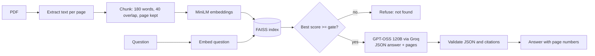

# Ask any PDF: a RAG question-answering system with an evaluation harness


Ask questions about a PDF and get a short answer with **page citations**. The system only answers from the document, and says so when it cannot find the answer instead of guessing.

> I built this to learn how retrieval-augmented generation really behaves, so the repo includes a small **evaluation harness** that measures retrieval quality, answer accuracy, citation accuracy and refusal behaviour, rather than just a demo.

**Live demo:** _FILL: your Streamlit link_ (upload any text-based PDF, or try the built-in sample handbook)

<!-- Add a screenshot or GIF of the app here:   -->

## What it does

- Extracts text page by page (`pypdf`) and splits it into overlapping word chunks that remember their page number
- Embeds chunks with `all-MiniLM-L6-v2` and searches them with a FAISS index (cosine similarity)
- Sends only the top-k chunks to GPT-OSS 120B (Groq free tier) with a strict "answer only from context" prompt
- Forces **structured JSON output** (`answer`, `found`, `pages`) and validates it: page citations that were not in the retrieved chunks are dropped
- **Similarity gate:** if even the best chunk is below a threshold, it refuses without calling the LLM
- **Streamlit web app where anyone can upload their own PDF** (indexed in memory per session, with page and question limits for a public deployment, and an option to bring your own API key)
- Command line interface, Dockerfile, unit tests and CI

## Architecture



## Quick start

```bash
git clone https://github.com/YOUR-USERNAME/rag-pdf-qa.git
cd rag-pdf-qa
python -m venv .venv && source .venv/bin/activate        # Windows: .venv\Scripts\activate
pip install -r requirements.txt
cp .env.example .env                                     # then paste your free Groq key

python -m ragqa.cli build --pdf data/your_document.pdf   # build the index (once)
python -m ragqa.cli ask "What is the minimum attendance required?"
streamlit run app.py                                     # web UI: upload any PDF
```

Get a free API key at https://console.groq.com. PDFs are git-ignored; bring your own.

## Evaluation

The questions live in `eval/questions.json`. Each answerable question has expected keywords and the page(s) where the answer is. Unanswerable questions check that the system refuses.

```bash
python -m eval.make_questions -n 12                      # LLM-drafted questions, reviewed by hand
python -m eval.sweep --pdf data/your_document.pdf        # compare chunk sizes (no LLM calls)
python -m eval.run_eval                                  # full evaluation
```

**Reproduce it on the bundled sample** (a synthetic 5-page handbook, so anyone can re-run it):

```bash
python -m ragqa.cli build --pdf sample/sample_handbook.pdf
python -m eval.run_eval --questions eval/questions.sample.json
```

**Document used for the results below:** _FILL: name of the PDF, number of pages_

**Chunk-size experiment** (retrieval only):

_FILL: paste eval/results/sweep.md here_

**Full pipeline results** (chosen settings):

_FILL: paste eval/results/latest.md here_

**Error analysis:** _FILL: 2 or 3 sentences about what the wrong answers had in common (for example: answers split across two pages, tables read badly, questions that need a list)._

How the metrics are defined:

| Metric | Meaning |
|---|---|
| Retrieval hit@k | A chunk from an expected page is among the top-k retrieved |
| MRR | Mean reciprocal rank of the first relevant chunk |
| Answer accuracy | Every expected keyword appears in the answer |
| Citation accuracy | The cited pages include an expected page |
| Correct refusals | Off-topic questions answered with "not found" |

## Design decisions

- **180-word chunks.** MiniLM truncates input at about 256 tokens, so longer chunks would silently lose text. The sweep above checks this empirically.
- **Page-level relevance labels.** Using pages (not chunk IDs) keeps the evaluation valid when the chunking changes.
- **Validate model output.** JSON mode makes the format reliable, not the content. Citations are checked against what was actually retrieved.
- **Refuse early.** The similarity gate saves an LLM call and removes a class of hallucinations for off-topic questions.

## Limitations

- Small evaluation set (about 15 questions), partly LLM-drafted and then hand-reviewed, so numbers are indicative, not rigorous
- Page-based relevance marks a correct chunk from a neighbouring page as a miss
- Tables and scanned PDFs are not handled (no OCR, text-only extraction)
- Each question is answered independently; there is no conversation memory
- Pure dense retrieval; exact-term queries (clause numbers, codes) can be missed

## Ideas for next steps

- Hybrid retrieval (BM25 + embeddings) and a cross-encoder re-ranker
- Conversation memory with query rewriting
- Incremental indexing for several documents
- An LLM-as-judge check for answer faithfulness

## Project structure

```
ragqa/            core package (loader, chunking, index, retriever, answer, metrics, evaluation, cli)
app.py            Streamlit web app (upload any PDF)
sample/           synthetic sample handbook for the demo and reproducible evaluation
eval/             question generator, evaluation runner, chunk-size sweep, results
tests/            unit tests + an offline end-to-end test (fake embedder)
```

Run the tests with `pip install -r requirements-dev.txt && pytest`.

## Privacy and limits of the public demo

Uploaded PDFs are processed in memory and not stored. The passages retrieved for a question are sent to the Groq API, so do not upload confidential documents. The demo limits PDFs to 150 pages and 25 MB, and each session to 25 questions on the shared key (visitors can paste their own free Groq key to continue).

## Run with Docker

```bash
docker build -t rag-pdf-qa .
docker run -p 8501:8501 --env-file .env -v "$(pwd)/data:/app/data" -v "$(pwd)/index:/app/index" rag-pdf-qa
```

Build the index first (or let the app build it from the first PDF in `data/`).

## License

MIT. Built by Nivedha K.
